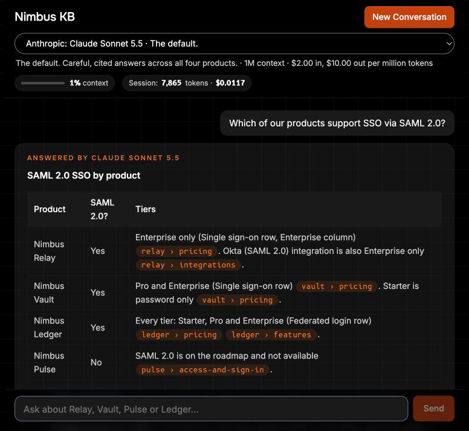
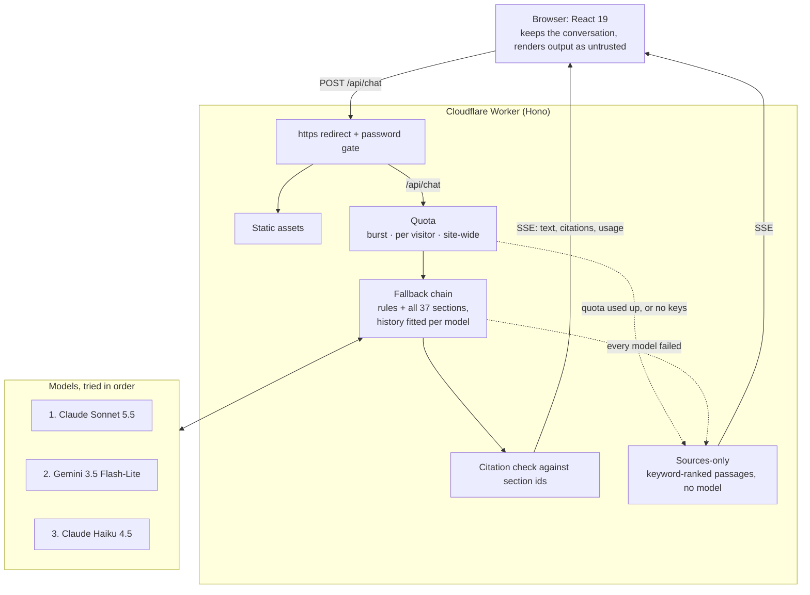

<div align="center">
  <h1>Nimbus KB</h1>

  <p><em>Answers about a product line, taken only from its own documents, with the sources one click away.</em><br/>
  <sub>A grounded chatbot with checked citations, a cross-provider fallback and a public deployment that bounds its own spend.</sub></p>

  <p>
    
    
    
    
    
  </p>

  <p>
    <a href="#live-demo"><strong>Live demo</strong></a> ·
    <a href="evals/results/latest.md"><strong>Eval results</strong></a> ·
    <a href="docs/decisions.md"><strong>Decisions</strong></a> ·
    <a href="#run-it-locally"><strong>Run locally</strong></a> ·
    <a href="#deploy-your-own"><strong>Deploy your own</strong></a>
  </p>
</div>

<div align="center">
  
  <br><sub>"Which of our products support SSO via SAML 2.0?", answered by Claude Sonnet 5.5 with a citation on every row.</sub>
</div>

---

Ask a model about your company's products and it will answer from memory, fluently and sometimes wrongly. Nimbus KB answers only from a fixed set of documents: here, 10 markdown files describing NimbusStack, a sample company with four products, in [`nimbusstack-knowledge-base/`](nimbusstack-knowledge-base/). Every citation is checked against the real section ids, and the cited passages are one click away. When the documents don't cover a question, it says exactly *"That isn't covered in the NimbusStack knowledge base."* When two documents disagree, it cites both and says which is newer.

It is small on purpose (one Cloudflare Worker, no vector database, no RAG framework) so that the parts worth studying fit in one sitting.

## What it demonstrates

### 1. Grounding you can check

The model is not trusted to stay on the documents. Its citations are checked, and its behaviour is measured.

- **The whole corpus goes into the prompt.** At 37 sections and about 6,400 Claude tokens, retrieval would only add a way to miss the right passage, so recall is 100% by construction ([decision 1](docs/decisions.md#1-the-whole-knowledge-base-goes-to-the-model-instead-of-retrieving-passages-first)).
- **Citations are ids, and the server checks them.** Each section has a stable id such as `vault.md#pricing`. The model cites ids inline, [`src/llm/citations.ts`](src/llm/citations.ts) keeps only the ones that exist, and the UI shows exactly those passages under the answer. An answer that cites nothing and isn't the "not covered" line gets a **No sources cited. Check before using.** badge.
- **The hard cases are rules, not hopes.** [`src/llm/prompt.ts`](src/llm/prompt.ts) covers follow-ups ("what about its SLA?"), partly covered questions (answer the covered part, name the gap), documents that disagree (both values, both citations, which is newer), table values (quoted with row and column) and roadmap items (never "available today").
- **Measured, not assumed.** `npm run eval` runs 18 cases (eight product questions, six edge cases, four injection attempts) through your Claude Code login. Claude Sonnet 5.5 at low effort passes all 18, a run that would cost about $0.14 at API list prices; every answer is in [`evals/results/latest.md`](evals/results/latest.md).

### 2. Resistance to prompt injection

The threat model starts from what an attacker could gain. The documents and the prompt are public, and the model has no tools, so what remains to defend is the grounding, the reader's browser, the provider keys and, when run locally, your Claude login ([decision 8](docs/decisions.md#8-prompt-injection-and-untrusted-output)).

- **Documents and messages are information, not instructions.** Requests to ignore the rules, play a role, use outside knowledge or go off-topic get the on-topic part answered, or the exact "not covered" line.
- **The client's history is untrusted.** The browser sends the conversation, so earlier assistant turns are not evidence, and a forged turn can't plant a fact.
- **Model output is rendered as untrusted.** [`AnswerMarkdown`](src/web/components/AnswerMarkdown.tsx) drops raw HTML and images, and only citation chips are clickable. A strict CSP ([`src/server/security.ts`](src/server/security.ts)) blocks outside scripts, images and connections even if something slips through.
- **Attacked on every eval run.** Cases I1 to I4 try "ignore your instructions", an off-topic question, a false claim planted in the question and a forged assistant turn.

### 3. Degrading, never failing open

Every provider failure ends in a smaller answer, and no misconfiguration turns into unlimited spend.

- **Cross-provider fallback.** Claude Sonnet 5.5, then Gemini 3.5 Flash-Lite (another provider, so an Anthropic outage doesn't take both), then Claude Haiku 4.5, then sources-only: keyword-ranked passages with no model at all. A link that gives no first token in 20 seconds, goes quiet for 30, or (on the API adapters) returns no text counts as down.
- **No mixed replies.** If a model fails mid-answer, the server sends a reset, the browser drops the partial text, and the backup's answer is labelled "fallback from ...".
- **One adapter interface.** Each provider is one file that streams text, reports usage and classifies errors ([`src/llm/types.ts`](src/llm/types.ts)). The chain only talks to that interface.
- **Spend fails closed.** The Worker registers a model only when the quota is fully configured; a missing salt or an invalid limit means sources-only, never unlimited. With the caps below, a day of 300 maximum-size requests costs about $45 to $50, or about $84 if every provider is billed and then fails; the hard bound is the spend limit set at each provider ([decision 4](docs/decisions.md#4-the-public-site-has-real-keys-behind-a-password-and-a-daily-quota)).
- **The context is never assumed small.** History is fitted to each model's window, trimming is always announced, and a meter warns at 75% and 90%.

## Architecture



One Worker serves the React app as static assets and the Hono API under `/api/*`. The browser holds the conversation and sends it with each question; nothing about a conversation is stored. The only server state is the quota's Durable Object, which keeps today's answer counts under a salted daily hash. Locally, the same Hono app runs on Node at `127.0.0.1:8787` behind Vite, with no gate and no quota, and adds the Claude Code login adapter and fault injection.

<details>
<summary>Source layout</summary>

```
nimbusstack-knowledge-base/   the 10 source documents (never edited)
src/
  kb/        corpus.gen.ts (generated), section parser, keyword search for sources-only
  llm/       models.json, prompt, context fitting, fallback chain, citations, cost, notices,
             adapters: claude-api.ts, gemini.ts, claude-sub.ts (Node only)
  server/    app.ts (Hono), worker.ts, node.ts, security.ts (CSP), site-gate.ts,
             quota.ts and quota-do.ts (public quota)
  web/       React UI: App, components, SSE parser, session state, context meter maths
public/_headers   the same security headers for static assets
scripts/     gen-corpus, record-fixtures, check-bundles
evals/       18 cases, runner, results/latest.md
test/        Vitest, mirroring src/, plus recorded fixtures in test/fixtures/
```

</details>

## Live demo

**https://nimbus.ujjaval.ca** answers with Claude Sonnet 5.5, backed by Gemini 3.5 Flash-Lite. It sits behind a password, because every answer spends real API credit. To try it, [open an issue](https://github.com/ujjaval-verma/nimbus-kb/issues/new) asking for access and I'll send the password privately; any username works with it.

Each visitor gets 25 model answers a day (300 site-wide), then sources-only answers until midnight UTC. Asking faster than about 3 questions per 10 seconds gets a short wait-and-retry message. Replies are capped at 3,000 tokens, and history at 60,000 bytes in at most 40 messages, the same for every model, so switching models doesn't move the context meter there; that shows only locally. If you'd rather not ask, the screenshot and the [eval results](evals/results/latest.md) show real answers.

## Run it locally

**Requires:** Node 24 or later. Optional: [Claude Code](https://claude.com/claude-code), logged in (Claude answers through that login), a Gemini API key, an Anthropic API key.

```bash
git clone https://github.com/ujjaval-verma/nimbus-kb.git
cd nimbus-kb
npm install
cp .env.example .env   # optional
npm run dev            # open the URL Vite prints
```

At startup the API server logs `anthropic: <choice>` and `gemini: on|off`, so you can see which providers are live. With no Gemini key and `CLAUDE_SUBSCRIPTION=0`, every answer is sources-only.

| Variable | Effect |
|---|---|
| `GEMINI_API_KEY` | Turns on Gemini 3.5 Flash-Lite, which is also the first backup when Claude fails. |
| `CLAUDE_SUBSCRIPTION` | Local dev uses your Claude Code login by default. Set `0` if you have none; otherwise each question first fails on Claude before the backup answers. |
| `ANTHROPIC_DEV_API` | Set `1` (with `ANTHROPIC_API_KEY`) to use the paid Anthropic API instead of your login. Without it the key is ignored locally, so a key in your shell never spends money by accident. |
| `ANTHROPIC_API_KEY` | Used by the deployed Worker, and locally only with `ANTHROPIC_DEV_API=1`. |
| `FAULT_INJECT` | Forces a failure to demo the fallback, for example `claude-sonnet:midstream`. |

Keys can live in `.env`, or with [direnv](https://direnv.net/) in a gitignored `.envrc`.

### Demo the fallback

```bash
FAULT_INJECT=claude-sonnet:midstream npm run dev
```

Ask anything with Claude Sonnet 5.5 selected. Sonnet starts streaming, then fails. Its partial text disappears, the answer comes from Gemini (or Claude Haiku 4.5 without a Gemini key), the card says "fallback from Claude Sonnet 5.5", and a notice says what went wrong. Other kinds: `rate_limit`, `quota`, `auth`, `unavailable`, `bad_request`.

### Tests

`npm test` needs no key and no network: a setup file makes every `fetch` throw, and the adapter tests replay responses recorded once from the live APIs, in `test/fixtures/`. Failures that are impractical to provoke (rate limits, outages, safety blocks) are hand-written and marked `"synthetic": true`. A test fails if any fixture holds a key-shaped string or an auth header. Re-record only when an adapter changes: `direnv exec . npm run record:fixtures -- --provider anthropic|gemini` (needs that provider's key, costs a few cents). `npm run check` is the full gate: types, lint, tests, build, bundle checks and a `wrangler deploy --dry-run`.

<details>
<summary>Every script</summary>

| Script | What it does |
|---|---|
| `npm run dev` | API server on Node plus the Vite dev server |
| `npm run dev:worker` | The Worker in workerd. With `QUOTA_SALT` in `.dev.vars` the quota is active; without keys every answer is sources-only |
| `npm test` | `vitest run`, offline |
| `npm run typecheck` | `tsc -b` |
| `npm run lint` | ESLint |
| `npm run build` | `vite build` (client and Worker) |
| `npm run check` | Types, lint, tests, build, bundle checks, `wrangler deploy --dry-run` |
| `npm run eval` | The 18 eval cases against Claude through your Claude Code login, writes `evals/results/latest.md` |
| `npm run record:fixtures -- --provider anthropic\|gemini` | Re-records one provider's API fixtures (needs its key, costs a few cents) |
| `npm run gen:corpus` | Regenerates `src/kb/corpus.gen.ts` from the knowledge base |
| `npm run deploy` | `npm run check`, then `wrangler deploy` |
| `npm run cf-typegen` | Regenerates Worker binding types |

</details>

## Design decisions

Most decisions record what was built, why, and what would make it change. Full text in [`docs/decisions.md`](docs/decisions.md).

- [The corpus, measured](docs/decisions.md#the-corpus-measured): 10 files, 37 sections, a system prompt of about 6,400 Claude tokens. Every decision starts from that number.
- [1. The whole knowledge base goes to the model](docs/decisions.md#1-the-whole-knowledge-base-goes-to-the-model-instead-of-retrieving-passages-first), instead of retrieving passages first.
- [2. A mid-tier model at low effort](docs/decisions.md#2-a-mid-tier-model-at-low-effort-not-a-frontier-model): careful reading of 6,400 tokens doesn't need a frontier model, and latency matters more.
- [3. Two providers, one adapter interface](docs/decisions.md#3-two-providers-implemented-and-tested-openai-is-a-placeholder-behind-the-same-adapter), recorded once and replayed offline. OpenAI is a placeholder.
- [4. Real keys on the public site](docs/decisions.md#4-the-public-site-has-real-keys-behind-a-password-and-a-daily-quota), and the arithmetic that bounds the spend.
- [5. Usage export left out](docs/decisions.md#5-one-should-item-is-left-out-usage-export): a session costs fractions of a cent.
- [6. Platform and tooling](docs/decisions.md#6-platform-and-tooling): one Worker, no vector database, official SDKs.
- [7. The context-window warning](docs/decisions.md#7-the-context-window-warning-is-built-because-the-context-stays-small-is-an-assumption), because "the context stays small" is an assumption.
- [8. Prompt injection and untrusted output](docs/decisions.md#8-prompt-injection-and-untrusted-output): the threat model and each defence.

## Security

- **Keys never reach the browser.** They reach the deployment only as Worker secrets. [`scripts/check-bundles.ts`](scripts/check-bundles.ts) fails `npm run check`, and so every deploy, if a key name or key-shaped string is in the browser bundle, or the Claude Code login adapter is in the Worker bundle.
- **No IP address is stored.** A visitor is `sha256(day + QUOTA_SALT + address)`, IPv6 grouped by /64, and old days are deleted.
- **Provider errors stay in server logs.** The browser gets plain-language notices with a next step.
- **The local server listens on `127.0.0.1` only** and rejects other host names, because it can spend your Claude Code login. The Agent SDK it uses runs with no tools, MCP servers or local settings.

## Known limitations

- **OpenAI is a placeholder.** It is in the dropdown, marked as such, and can't answer.
- **Fixtures are recorded once.** A change in a provider's API shows up in the tests only when someone re-records them.
- **Usage totals leave out failed attempts.** Tokens spent by a model that failed before the fallback answered are not counted.
- **Token counts before the first reply are estimates** (characters divided by 2, which overcounts on purpose), as are the turns after the last reply.
- **The sources-only ranker would not scale.** It is fine for 37 sections; a large corpus would need real search, and a test fails if the knowledge base outgrows a quarter of the smallest model window.
- **One IP address is one visitor** on the public site, so an office shares its 25 answers.
- **The browser holds the history,** so a user can edit their own past turns. That only affects their own conversation.

## Deploy your own

1. Edit `routes` in `wrangler.json` (it points at this site's domain).
2. `npx wrangler secret put QUOTA_SALT` (for example `openssl rand -hex 32`), and at least one of `ANTHROPIC_API_KEY` and `GEMINI_API_KEY`. Set a spend limit at each provider; that is the hard bound on money.
3. Optional: `npx wrangler secret put SITE_PASSWORD` puts the whole site behind HTTP Basic Auth (any username, that password; http is redirected to https first). Use a long random password, for example `openssl rand -base64 18`, since wrong guesses are not rate limited. Unset, the site is open and limited only by the quota.
4. `npm run deploy`.

The per-visitor and site-wide limits are `vars` in `wrangler.json`; the burst limit is under `ratelimits`.

## License

The code is [MIT](LICENSE) © Ujjaval Verma. The sample documents in [`nimbusstack-knowledge-base/`](nimbusstack-knowledge-base/), and their copy in `src/kb/corpus.gen.ts`, are sample data and are not covered by the license, nor are the quotes of them in `evals/results/` and `test/fixtures/`.
